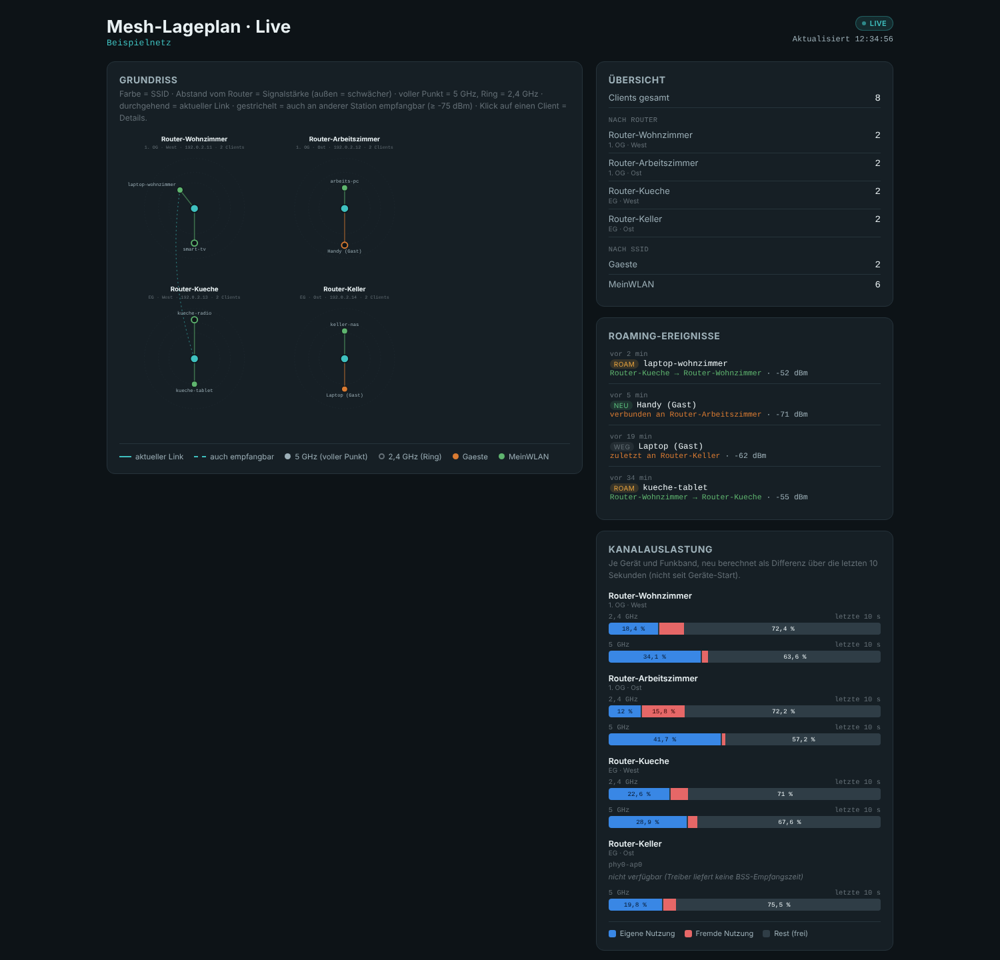

# Mesh Roaming Dashboard

[Deutsch](README.md) · **English**

## What is it?

A self-hosted live dashboard for OpenWrt-based WiFi mesh networks (usteer):
a floor-plan map showing which router each client is connected to, roaming
history, signal strength and channel utilization per radio — in your
browser, in real time. No cloud, no app, just one Python service that
polls your own routers over SSH.

It runs as a small Python 3 service (standard library only), either on a
Raspberry Pi (e.g. alongside openHAB, see
[`docs/deployment-raspbian-openhab.md`](docs/deployment-raspbian-openhab.md))
or directly on OpenWrt. Everything network-specific (routers, IPs, SSIDs,
map layout, thresholds) lives in one `config.json` — the service and the
web page stay the same for any mesh. See
[`examples/config.example.json`](examples/config.example.json) for the
format.

There are two deployment variants: Raspbian/Debian (works well alongside
openHAB, see above) and directly on a mesh router instead of a separate Pi,
with an optional LuCI configuration page — see
[`docs/deployment-openwrt.md`](docs/deployment-openwrt.md) and the
[`openwrt/`](openwrt) directory. The documentation in `docs/` and the code
comments are in German.



*Example view with made-up test data (routers, clients and values from
`examples/config.example.json`) — no real network data.*

## ⚠ Privacy notice (GDPR): this tool creates a personal movement profile

**This section is not an add-on, it is a prerequisite for using the tool.**
Please read it completely before installing the tool on your network —
especially if devices of other people (family, flatmates, tenants, guests,
visitors, possibly employees) use that network.

### What this tool actually records

For every device that connects to one of the monitored routers, the service
continuously records:

- which router/access point the device is currently connected to (and thus
  which place/room, if the router map is set up accordingly),
- which other access points can also receive it (including signal
  strength — an approximation of distance),
- every change of access point with its time (connect/roam/disconnect
  events, logged centrally in an SQLite database that survives a service
  restart),
- optionally a real name/nickname per device assigned by the operator,
  which explicitly links device → person,
- from the routers' DHCP leases and ARP table, the hostname and IP address
  of **all** devices on the network, including wired ones. Hostnames often
  already contain a person's name ("Annas-iPhone"). They are only stored
  for the retention period; the web interface only receives the hostnames
  of devices actually shown on the map, and no IP addresses at all.

**Since v22 this is time-limited by default, no longer unlimited:** the
configuration option `privacy.retention_days` (default: 7 days, adjustable
via UCI/LuCI on the "Datenschutz" (privacy) tab) automatically and
permanently deletes all device-related data (MAC address, name, IP,
nickname, roaming log entries) of a device from the SQLite database once it
has not been seen for that many days — not just from the display. In
addition, the service keeps (can be disabled via
`privacy.anonymous_stats_enabled`) an hourly, **MAC-free** summary (number
of events + average signal strength per router/band), which is kept
indefinitely. **Caution:** in a small household this statistic is not
reliably anonymous — if only one person lives there, "connect at 11 pm at
the bedroom router" shows when this person was where, even without a MAC
address (see "Known limitations" below). `POST /api/erase {"mac": "..."}`
deletes the data of a single device immediately at any time (Art. 17 GDPR),
regardless of the retention period. This does not change the following
sections: **during the retention period** a personal movement profile is
still created, and a legal basis for it (see below) is still required.

### Why this is a personal movement profile

WiFi-capable devices (smartphones above all) are practically always with
exactly one person in everyday life. The combination of "which device was
at which access point/place when", stored continuously over time, therefore
effectively results in a movement and location profile of the person who
owns the device — regardless of whether a real name is stored: a device MAC
address that is stable over time already makes a person re-identifiable
within the meaning of the GDPR, and a stored nickname makes this link
explicit. The dashboard is technically built for exactly this purpose
(showing where which device/person currently is in the monitored area and
how it moves there) — this is not a side effect, it is the core function.

This does not only affect the person who installs the tool: **every person
whose device connects to the monitored WiFi** is recorded — even without
their knowledge or consent, unless this is explicitly arranged. This
includes family members, flatmates, tenants of separate units in the same
mesh, guests, visitors and — when used outside a purely private
household — customers or employees.

### Legal assessment (overview, not legal advice)

- Location/movement data of an identifiable natural person is personal data
  within the meaning of Art. 4(1) GDPR. If it is used to analyse or predict
  a person's location or movement patterns, this may additionally qualify
  as profiling under Art. 4(4) GDPR.
- Every processing operation needs a legal basis under Art. 6 GDPR. In a
  shared network with several people, in practice this usually means the
  informed consent of everyone affected (Art. 6(1)(a) GDPR) — an overriding
  legitimate interest of the operator (Art. 6(1)(f) GDPR) will regularly be
  hard to justify for such a detailed, persistently stored movement profile
  of other people.
- The so-called household exemption (Art. 2(2)(c) GDPR) only applies to
  processing by a natural person for purely personal or household
  purposes — it no longer applies as soon as the tool records people
  outside this narrow circle (e.g. tenants of a separate unit, guests, or
  any use in a business/professional context).
- If affected people are informed, the transparency obligations of
  Art. 13/14 GDPR apply as well, together with the principles of data
  minimisation and storage limitation (Art. 5 GDPR) and the data subject
  rights (including access and erasure, Art. 15/17 GDPR).
- In an employment context, § 26 BDSG (German Federal Data Protection Act)
  and any co-determination rights of employee representatives must also be
  considered.
- Covert, undisclosed location monitoring of people without their
  knowledge (e.g. of tenants or flatmates) may, depending on the
  circumstances and jurisdiction, also be relevant under criminal law, not
  just data protection law.

### Practical recommendations (voluntary, but strongly advised)

- Actively inform everyone whose devices use (or could use) the monitored
  WiFi before going live and — where possible — obtain their consent; no
  covert monitoring.
- Restrict access to the dashboard: the service has **no login** (see
  "Known limitations"). Make the port (default 8765) reachable only from
  the trusted network, e.g. set `http.bind` or the UCI option `bind` to the
  LAN IP instead of `0.0.0.0`, and make sure guest WiFi/IoT networks cannot
  reach the router or Pi through the firewall. For more protection, put a
  reverse proxy with authentication in front of it.
- Actively limit the storage period: `privacy.retention_days` (default
  7 days) automatically deletes device-related data from the SQLite
  database, not just from the display — unlike `log_max_entries`, which is
  still only a safety limit on the number of entries, not a time limit.
  Choose a period as short as your purpose (e.g. troubleshooting)
  requires.
- In small households, disable `privacy.anonymous_stats_enabled` if you do
  not need long-term trends.
- If MQTT is enabled, also limit retention in openHAB/InfluxDB (retention
  policy), because the number of clients per router ends up there
  permanently — and with it, who was in which room when.
- Do without the nickname/rename function if explicit re-identification of
  people is to be avoided.
- Limit operation to the group of people and time period actually needed
  instead of permanently recording all devices.
- For any use outside a purely private household (see household exemption
  above), get legal advice beforehand (data protection officer, lawyer).

### Technical safeguards (as of 1.1)

- **Storage limitation:** device-related data is deleted from the database
  after `privacy.retention_days` without being seen; individual devices
  immediately via `POST /api/erase`. SQLite runs with `secure_delete`, so
  deleted data does not remain as leftovers in the file.
- **File permissions:** the database, `config.json` (may contain the MQTT
  password), `known_hosts` and the MQTT options file are readable by the
  service only (0600).
- **No third parties:** the web interface does not load external fonts,
  scripts or CDNs — the viewer's browser only talks to the service itself.
- **Data minimisation in the output:** `/data.json` contains no IP
  addresses, and hostnames only for devices that appear on the map.
  `/config.json` and `/api/status` (status column in LuCI) contain no
  device data.
- **Protection against foreign websites (CSRF):** `POST /api/rename` and
  `/api/erase` only accept requests with `Content-Type: application/json`
  and a matching origin. A foreign website opened by someone on the home
  network therefore cannot rename devices or delete data. Command line:
  `curl -H 'Content-Type: application/json' -d
  '{"mac":"aa:bb:cc:dd:ee:ff"}' http://<host>:8765/api/erase`.
- **MQTT:** only totals are sent (clients per router, length of the event
  log), no MAC addresses or names. Credentials do not appear in the process
  list; TLS is supported and recommended for a broker outside the
  router/Pi.
- **No access logs:** the web server does not log requests (no viewer IP
  addresses in the log).

### Known limitations

- **No login:** anyone who can reach the port sees live which device is in
  which room, and can rename devices or delete their data. Protection only
  via network/firewall or a reverse proxy (see above).
- **Anonymous statistics:** kept indefinitely and traceable to individuals
  in small households.
- **Erasing a connected device:** `POST /api/erase` deletes the stored
  data, but a device that is still connected is recorded again on the next
  poll. The only permanent fix is to take the device off the monitored
  WiFi.
- **Router access:** the service logs in to all routers via SSH as `root`
  with a key. Whoever has the key has the routers — keep the file readable
  by root only (`chmod 600`).

**This section is not legal advice.** The actual data protection
assessment depends on the specific case (context of use, people affected,
applicable national law). If in doubt, seek expert advice before use.

## Features

- Live map with routers, clients and roaming arrows on a freely
  positionable floor plan (SVG, 900×600).
- Signal strength radar per client (rings at configurable dBm thresholds).
- Central event log (connect/roam/disconnect) in SQLite — consistent for
  all viewers, survives a service restart.
- Detail panel per client: history, current connection, which other
  routers can also receive the device.
- Channel utilization per router/band (own use / foreign use / unused
  capacity), from `iw dev <ifname> survey dump`.
- Client dots: filled dot = 5 GHz, ring = 2.4 GHz.
- Clients can be renamed in the UI (nickname), stored permanently.
- Optional: summary metrics via MQTT (e.g. for InfluxDB/Grafana),
  optionally with username/password and TLS.
- Automatic storage limitation (GDPR): device-related data expires after
  `privacy.retention_days` (default 7 days), a MAC-free long-term statistic
  is kept for trend analysis, immediate erasure of individual devices via
  `POST /api/erase`.

## Architecture

- `src/mesh_roaming_pi.py` — the service: polls all routers via SSH (one
  background thread per router), combines the results and serves the live
  page plus `/config.json`/`/data.json` over HTTP.
- `src/mesh-lageplan-live.html` — the live page itself. Contains **no**
  network-specific data, loads everything from the server.
- `examples/config.example.json` / `examples/config.template.json` —
  example and placeholder configuration as a starting point for your own
  `config.json`.
- `systemd/mesh-roaming.service` — systemd unit for continuous operation
  on Raspbian/Debian.
- `openwrt/mesh-roaming/` — OpenWrt package source (procd init script, UCI
  configuration schema, UCI→JSON bridge `mesh-roaming-uci2json`) for
  running directly on a mesh router instead of a separate Pi.
- `openwrt/luci-app-mesh-roaming/` — optional LuCI configuration pages for
  the OpenWrt package (basic settings, routers, SSID colours).
- `openwrt/build-ipk.sh` — builds installable `.ipk` files from both
  package sources (without the OpenWrt SDK).
- `packages/` — ready-built packages of the current version.

Requirement on the routers: OpenWrt with `usteer` and `hostapd` (the
default in most current mesh setups).

## Quick start (OpenWrt, directly on a mesh router)

**Important — first check which package manager the router uses**
(`opkg --version` or `apk --version`): since OpenWrt 25.12, `apk`
(Alpine style) is the default on many targets instead of `opkg` — a
different package format, not just a different command. An `.ipk` cannot
be installed with `apk`.

### Ready-built packages (no build needed)

The [`packages/`](packages/) directory contains ready-built packages of
the current version (architecture `all`, run on any target):

| File | for |
|---|---|
| `mesh-roaming_1.1-r1_all.apk` | service, OpenWrt 25.12+ (`apk`) |
| `luci-app-mesh-roaming_1.1-r1_all.apk` | LuCI pages, OpenWrt 25.12+ (`apk`) |
| `mesh-roaming_1.1-r1_all.ipk` | service, OpenWrt up to 24.10 (`opkg`) |
| `luci-app-mesh-roaming_1.1-r1_all.ipk` | LuCI pages, OpenWrt up to 24.10 (`opkg`) |

```sh
# on the PC: copy the packages to the router (-O: Dropbear has no SFTP)
scp -O packages/*_1.1-r1_all.apk packages/SHA256SUMS root@<router-ip>:/tmp/

# on the router (apk, OpenWrt 25.12+)
cd /tmp
grep apk SHA256SUMS | sha256sum -c -   # optional: packages intact?
apk update
apk add --allow-untrusted ./mesh-roaming_1.1-r1_all.apk ./luci-app-mesh-roaming_1.1-r1_all.apk

# or on the router (opkg, up to OpenWrt 24.10)
opkg update
opkg install ./mesh-roaming_1.1-r1_all.ipk ./luci-app-mesh-roaming_1.1-r1_all.ipk
```

The package manager fetches the dependencies (`python3`, `python3-sqlite3`,
`openssh-client-utils`, `luci-base`, `rpcd`) from the OpenWrt package
feeds itself, so run `apk update` or `opkg update` first.
`--allow-untrusted` is required because the packages are not signed with
an OpenWrt key. The `.apk` files are built in APK v2 format and tested on
OpenWrt 25.12.6 (x86/64); the `.ipk` files have not been tested against a
real `opkg`. Then add your routers in LuCI under
*Services → Mesh Roaming Dashboard*. The LuCI pages are in German.

### Building yourself

```sh
cd openwrt
./build-ipk.sh
# -> openwrt/dist/mesh-roaming_<version>_all.ipk
# -> openwrt/dist/luci-app-mesh-roaming_<version>_all.ipk   (optional, LuCI pages)

./build-apk.sh   # ONLY for apk routers: additionally converts the .ipk files to .apk
```

Then copy to the router with `scp` and install with `opkg install` (or
`apk add --allow-untrusted` for `.apk`). Full instructions (package
manager detection, `.apk` conversion incl. APK v2/v3, configuration via
LuCI or UCI, SSH keys, uninstalling), in German:
[`docs/deployment-openwrt.md`](docs/deployment-openwrt.md).

## Quick start (Raspbian/Debian, e.g. alongside openHAB)

See [`docs/deployment-raspbian-openhab.md`](docs/deployment-raspbian-openhab.md)
(in German) for the full instructions (service user, configuration, SSH
keys, systemd).

Short version for trying it out locally:

```sh
cp examples/config.example.json /tmp/config.json
# edit /tmp/config.json: enter your own routers/IPs/SSIDs
MESH_ROAMING_CONFIG=/tmp/config.json python3 src/mesh_roaming_pi.py
```

Then open in the browser: **http://localhost:8765/** (or, when running on
the Pi: `http://<ip-or-hostname-of-the-pi>:8765/` — port 8765 can be
changed in `config.json` under `http.port`).

`openwrt/feed-makefiles/` contains templates for a possible later
submission to the official `openwrt/packages` feed. This has not been done
yet — among other things because the current licence (PolyForm
Noncommercial, see below) is probably not compatible with the licence
requirements of the official feed, which is also redistributed in
commercial firmware images.

## License

[PolyForm Noncommercial License 1.0.0](https://polyformproject.org/licenses/noncommercial/1.0.0) —
see [`LICENSE`](LICENSE). Private, scientific, charitable and other
non-commercial use, modification and redistribution are freely permitted.
**Commercial licences available on request.**
