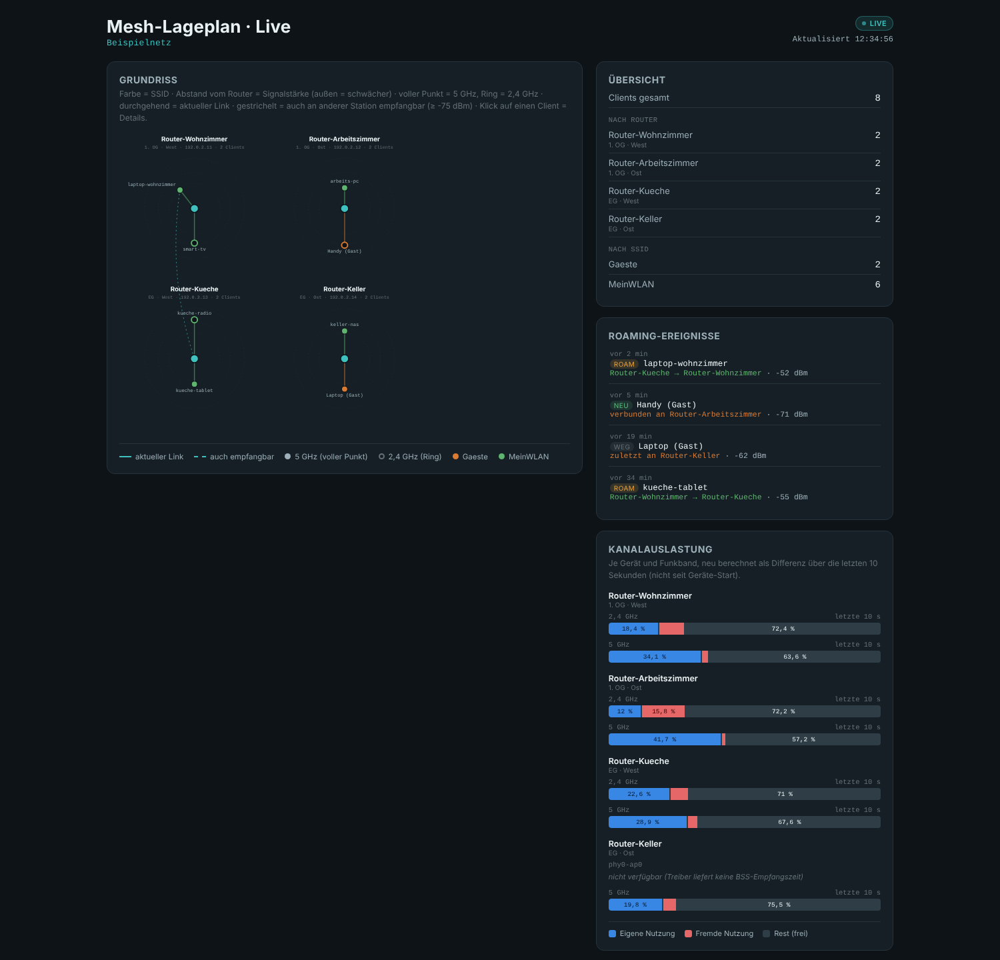

# Mesh Roaming Dashboard

A self-hosted, live dashboard for OpenWrt-based WiFi mesh networks (usteer):
a floor-plan map showing which router each client is connected to, roaming
history, signal strength and per-radio channel utilization — in your
browser, updated in real time. No cloud, no app, just one Python service
polling your routers over SSH.

Runs as a small Python 3 (standard-library only) service, either directly
on a Raspberry Pi (e.g. alongside openHAB — see
[`docs/deployment-raspbian-openhab.md`](docs/deployment-raspbian-openhab.md))
or on OpenWrt itself. Everything network-specific (routers, IPs, SSIDs,
floor-plan layout, thresholds) lives in one `config.json` — the service and
the web page stay the same for any mesh. See
[`examples/config.example.json`](examples/config.example.json) for the
format.

Two deployment variants are available: Raspbian/Debian (openHAB-friendly,
see above) and an OpenWrt-router-hosted variant that runs directly on a
mesh router instead of a separate Pi, with an optional LuCI configuration
page — see
[`docs/deployment-openwrt.md`](docs/deployment-openwrt.md) and the
[`openwrt/`](openwrt) directory.

**⚠ Privacy / GDPR notice:** this tool tracks, for every device on your
network, which router/room it is near and when it moves between them,
and stores that history persistently. If devices are tied to individuals
(phones usually are), this is personal movement-profile data about real
people — not just about "your network". Operating this requires a legal
basis under the GDPR/DSGVO (and any other applicable law) for everyone
whose devices appear, not only the operator. See the German section
"Datenschutz-Hinweis (DSGVO)" below for the full explanation — this is
not legal advice.

The documentation below is in German, matching the project's origin; code
comments are German throughout.

---

## Was ist das?

Eine selbst gehostete Live-Karte für ein OpenWrt-Mesh-Netzwerk (usteer):
zeigt auf einem Grundriss, an welchem Router jeder Client gerade hängt,
Roaming-Verlauf, Signalstärke und Kanalauslastung je Funkband – im Browser,
in Echtzeit. Keine Cloud, keine App, nur ein Python-Dienst, der die eigenen
Router per SSH abfragt.

Läuft als kleiner Python-3-Dienst (reine Standardbibliothek) – entweder auf
einem Raspberry Pi (z. B. neben openHAB, siehe
[`docs/deployment-raspbian-openhab.md`](docs/deployment-raspbian-openhab.md))
oder direkt auf OpenWrt. Alles Netzwerkspezifische (Router, IPs, SSIDs,
Kartenlayout, Schwellwerte) steckt in einer `config.json` – Dienst und
Webseite bleiben für jedes Mesh identisch gleich.



*Beispielansicht mit frei erfundenen Testdaten (Router, Clients und Werte
aus `examples/config.example.json`) – keine echten Netzwerkdaten.*

## ⚠ Datenschutz-Hinweis (DSGVO): Dieses Tool erstellt ein personenbezogenes Bewegungsprofil

**Dieser Abschnitt ist kein Zubehör, sondern Voraussetzung für den Einsatz.**
Bitte vollständig lesen, bevor dieses Tool im eigenen Netzwerk installiert
wird – insbesondere, wenn im Netzwerk auch Geräte anderer Personen
(Familie, Mitbewohner, Mieter, Gäste, Besuch, ggf. Mitarbeitende) laufen.

### Was dieses Tool tatsächlich erfasst

Für jedes Gerät, das sich mit einem der überwachten Router verbindet,
zeichnet der Dienst laufend und dauerhaft auf:

- an welchem Router/Access Point (und damit an welchem Ort/Raum, sofern
  die Router-Karte entsprechend eingerichtet ist) das Gerät aktuell
  verbunden ist,
- an welchen weiteren Access Points es zusätzlich empfangbar ist
  (inklusive Signalstärke – ein Näherungsmaß für die Entfernung),
- jeden Wechsel des Access Points samt Zeitpunkt (Connect-/Roam-/
  Disconnect-Ereignisse, zentral protokolliert in einer SQLite-Datenbank,
  die einen Dienst-Neustart überlebt und ohne eigenes Eingreifen nicht
  automatisch geleert wird),
- optional einen vom Betreiber vergebenen Klarnamen/Nickname pro Gerät,
  der dauerhaft gespeichert wird und die Zuordnung Gerät → Person
  ausdrücklich und dauerhaft herstellt.

### Warum das ein personenbezogenes Bewegungsprofil ist

WLAN-fähige Geräte (vor allem Smartphones) befinden sich im Alltag
praktisch ständig bei genau einer Person. Die Kombination aus "welches
Gerät ist wann an welchem Access Point/Ort", fortlaufend über die Zeit
gespeichert, ergibt damit faktisch ein Bewegungs- und Aufenthaltsprofil
der Person, der das Gerät gehört – unabhängig davon, ob ein Klarname
hinterlegt ist: Schon eine über die Zeit stabile Geräte-MAC-Adresse macht
eine Person im Sinne der DSGVO re-identifizierbar, ein hinterlegter
Nickname stellt diesen Bezug zusätzlich ausdrücklich her. Das Dashboard
ist technisch genau für diesen Zweck gebaut (Sichtbarmachen, wo sich
welches Gerät/welche Person im überwachten Bereich gerade aufhält und wie
es sich dort bewegt) – das ist kein Nebeneffekt, sondern die Kernfunktion.

Das betrifft nicht nur die Person, die das Tool installiert: **jede
Person, deren Gerät sich mit dem überwachten WLAN verbindet**, wird
erfasst – auch ohne eigenes Wissen oder eigene Zustimmung, sofern nicht
ausdrücklich dafür gesorgt wird. Das schließt Familienmitglieder,
Mitbewohner, Mieter separater Einheiten im selben Mesh, Gäste, Besuch und
– bei Einsatz außerhalb eines rein privaten Haushalts – auch Kunden oder
Mitarbeitende ein.

### Rechtliche Einordnung (Überblick, keine Rechtsberatung)

- Standort-/Bewegungsdaten einer identifizierbaren natürlichen Person sind
  personenbezogene Daten im Sinne von Art. 4 Nr. 1 DSGVO. Werden sie dazu
  verwendet, Aufenthalts- oder Bewegungsmuster einer Person zu analysieren
  oder vorherzusagen, kann das zusätzlich als Profiling nach Art. 4 Nr. 4
  DSGVO einzuordnen sein.
- Jede Verarbeitung braucht eine Rechtsgrundlage nach Art. 6 DSGVO. In
  einem gemeinsam genutzten Netzwerk mit mehreren Personen kommt dafür in
  der Praxis meist nur eine informierte Einwilligung aller betroffenen
  Personen in Betracht (Art. 6 Abs. 1 lit. a DSGVO) – ein überwiegendes
  berechtigtes Interesse des Betreibers (Art. 6 Abs. 1 lit. f DSGVO) wird
  bei einem derart detaillierten, dauerhaft gespeicherten Bewegungsprofil
  anderer Personen regelmäßig schwer zu begründen sein.
- Die sogenannte Haushaltsausnahme (Art. 2 Abs. 2 lit. c DSGVO) gilt nur
  für die Verarbeitung durch eine natürliche Person zu ausschließlich
  persönlichen oder familiären Zwecken – sie entfällt, sobald das Tool
  Personen außerhalb dieses engen Kreises erfasst (z. B. Mieter einer
  separaten Wohneinheit, Gäste, oder jeglicher Einsatz in einem
  geschäftlichen/beruflichen Kontext).
- Werden betroffene Personen informiert, greifen zusätzlich die
  Transparenzpflichten aus Art. 13/14 DSGVO (wer wird worüber informiert)
  sowie die Grundsätze der Datenminimierung und Speicherbegrenzung
  (Art. 5 DSGVO) und die Betroffenenrechte (u. a. Auskunft, Löschung,
  Art. 15/17 DSGVO).
- Bei Einsatz im Beschäftigungskontext sind zusätzlich § 26 BDSG und ggf.
  Mitbestimmungsrechte der Arbeitnehmervertretung zu prüfen.
- Eine heimliche, nicht offengelegte Standortüberwachung von Personen
  ohne deren Kenntnis (z. B. von Mietern oder Mitbewohnern) kann je nach
  Ausgestaltung und Rechtsordnung über das Datenschutzrecht hinaus auch
  strafrechtlich relevant sein.

### Praktische Empfehlungen (freiwillig, aber dringend angeraten)

- Alle Personen, deren Geräte das überwachte WLAN nutzen (könnten), vor
  Inbetriebnahme aktiv informieren und – wo möglich – deren Einwilligung
  einholen; keine heimliche Überwachung.
- Zugriff auf das Dashboard und auf die SQLite-Datenbank technisch
  einschränken: Der Dienst ist bewusst **ohne Zugriffsschutz**
  ausgelegt (jeder im Netzwerk kann `/data.json` abrufen, s. Abschnitt
  "Offene Punkte" in der internen Projektdokumentation) – für den
  Einsatz außerhalb eines vollständig vertrauenswürdigen Heimnetzes
  zusätzliche Absicherung (z. B. Reverse-Proxy mit Authentifizierung,
  Netzwerksegmentierung) selbst ergänzen.
- Speicherdauer aktiv begrenzen: Die Konfigurationsoption
  `log_max_entries` begrenzt nur die in der Oberfläche angezeigte Anzahl
  Ereignisse, **nicht** automatisch die Daten in der SQLite-Datenbank –
  für eine echte Speicherbegrenzung eigene Löschroutinen ergänzen.
- Auf die Nickname/Umbenennen-Funktion verzichten, wenn eine
  ausdrückliche Re-Identifizierung von Personen vermieden werden soll.
- Betrieb auf den tatsächlich benötigten Personenkreis und Zeitraum
  beschränken statt dauerhaft alle Geräte zu erfassen.
- Bei jedem Einsatz außerhalb eines rein privaten, familiären Haushalts
  (siehe Haushaltsausnahme oben) vorab rechtlichen Rat (Datenschutz-
  beauftragte/r, Rechtsanwalt/Rechtsanwältin) einholen.

**Dieser Abschnitt ersetzt keine Rechtsberatung.** Die tatsächliche
datenschutzrechtliche Bewertung hängt vom konkreten Einzelfall ab
(Einsatzkontext, betroffene Personen, anwendbares nationales Recht). Im
Zweifel vor dem Einsatz fachkundigen Rat einholen.

## Funktionsumfang

- Live-Karte mit Routern, Clients und Roaming-Pfeilen auf einem frei
  positionierbaren Grundriss (SVG, 900×600).
- Signalstärke-Radar je Client (Ringe bei konfigurierbaren dBm-Schwellen).
- Zentrales Ereignis-Log (Connect/Roam/Disconnect) in SQLite – konsistent
  für alle Betrachter, überlebt einen Dienst-Neustart.
- Detail-Panel je Client: Verlauf, aktuelle Verbindung, an welchen weiteren
  Routern das Gerät ebenfalls empfangbar ist.
- Kanalauslastung je Router/Funkband (eigene Nutzung / fremde Nutzung /
  ungenutzte Kapazität), aus `iw dev <ifname> survey dump`.
- Client-Punkte: voller Punkt = 5 GHz, Ring = 2,4 GHz.
- Clients lassen sich im UI umbenennen (Nickname), bleibt dauerhaft
  gespeichert.
- Optional: Zusammenfassungs-Metriken per MQTT (z. B. für InfluxDB/Grafana).

## Architektur

- `src/mesh_roaming_pi.py` – der Dienst: pollt alle Router per SSH (ein
  Hintergrund-Thread je Router), fasst die Ergebnisse zusammen und liefert
  per HTTP die Live-Seite sowie `/config.json`/`/data.json`.
- `src/mesh-lageplan-live.html` – die Live-Seite selbst. Enthält **keine**
  netzwerkspezifischen Daten, lädt alles vom Server.
- `examples/config.example.json` / `examples/config.template.json` –
  Beispiel- bzw. Platzhalter-Konfiguration als Startpunkt für die eigene
  `config.json`.
- `systemd/mesh-roaming.service` – systemd-Unit für den Dauerbetrieb auf
  Raspbian/Debian.
- `openwrt/mesh-roaming/` – OpenWrt-Paketquelle (procd-Init-Skript, UCI-
  Konfigurationsschema, UCI→JSON-Brücke `mesh-roaming-uci2json`) für den
  Betrieb direkt auf einem Mesh-Router statt auf einem separaten Pi.
- `openwrt/luci-app-mesh-roaming/` – optionales LuCI-Konfigurationsformular
  für das OpenWrt-Paket (Grundeinstellungen, Router, SSID-Farben).
- `openwrt/build-ipk.sh` – baut aus beiden Paketquellen installierbare
  `.ipk`-Dateien (ohne OpenWrt-SDK).

Voraussetzung auf den Routern: OpenWrt mit `usteer` und `hostapd`
(Standard bei den meisten aktuellen Mesh-Setups).

## Schnellstart (OpenWrt, direkt auf einem Mesh-Router)

```sh
cd openwrt
./build-ipk.sh
# -> openwrt/dist/mesh-roaming_<version>_all.ipk
# -> openwrt/dist/luci-app-mesh-roaming_<version>_all.ipk   (optional, LuCI-Formular)
```

Danach per `scp`/`opkg install` auf den Router übertragen. Vollständige
Anleitung (Konfiguration über LuCI oder UCI, SSH-Schlüssel, Deinstallation):
[`docs/deployment-openwrt.md`](docs/deployment-openwrt.md).

## Schnellstart (Raspbian/Debian, z. B. neben openHAB)

Siehe [`docs/deployment-raspbian-openhab.md`](docs/deployment-raspbian-openhab.md)
für die vollständige Anleitung (Dienst-Nutzer, Konfiguration, SSH-Schlüssel,
systemd).

Kurzform zum lokalen Ausprobieren:

```sh
cp examples/config.example.json /tmp/config.json
# /tmp/config.json anpassen: eigene Router/IPs/SSIDs eintragen
MESH_ROAMING_CONFIG=/tmp/config.json python3 src/mesh_roaming_pi.py
```

Danach im Browser öffnen: **http://localhost:8765/** (bzw. bei echtem
Betrieb auf dem Pi: `http://<ip-oder-hostname-des-pi>:8765/` – der Port
8765 lässt sich in der `config.json` unter `http.port` ändern).

`openwrt/feed-makefiles/` enthält Vorlagen für eine mögliche spätere
Veröffentlichung im offiziellen `openwrt/packages`-Feed. Das ist noch nicht
umgesetzt – unter anderem, weil die aktuelle Lizenz (PolyForm Noncommercial,
siehe unten) mit den Lizenzanforderungen des offiziellen Feeds vermutlich
nicht vereinbar ist, da dieser auch in kommerziellen Firmware-Images
mitverteilt wird.

## Lizenz

[PolyForm Noncommercial License 1.0.0](https://polyformproject.org/licenses/noncommercial/1.0.0) –
siehe [`LICENSE`](LICENSE). Private, wissenschaftliche, gemeinnützige und
sonstige nicht-kommerzielle Nutzung, Veränderung und Weitergabe sind damit
frei möglich. **Kommerzielle Lizenzen auf Anfrage.**
