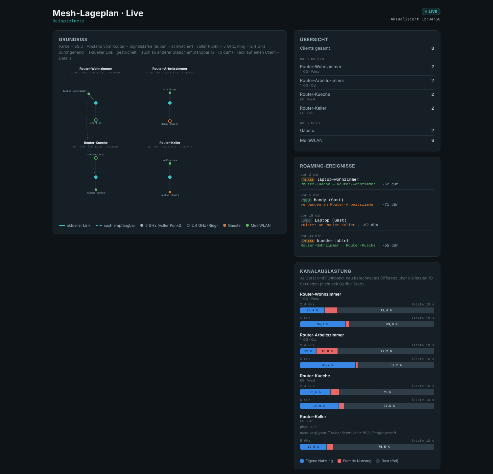

# Mesh Roaming Dashboard

**Deutsch** · [English](README.en.md)

## Was ist das?

Eine selbst gehostete Live-Karte für ein OpenWrt-Mesh-Netzwerk (usteer):
zeigt auf einem Grundriss, an welchem Router jeder Client gerade hängt,
Roaming-Verlauf, Signalstärke und Kanalauslastung je Funkband – im Browser,
in Echtzeit. Keine Cloud, keine App, nur ein Python-Dienst, der die eigenen
Router per SSH abfragt.

Läuft als kleiner Python-3-Dienst (reine Standardbibliothek) – entweder auf
einem Raspberry Pi (z. B. neben openHAB, siehe
[`docs/deployment-raspbian-openhab.md`](docs/deployment-raspbian-openhab.md))
oder direkt auf OpenWrt. Alles Netzwerkspezifische (Router, IPs, SSIDs,
Kartenlayout, Schwellwerte) steckt in einer `config.json` – Dienst und
Webseite bleiben für jedes Mesh identisch gleich. Das Format zeigt
[`examples/config.example.json`](examples/config.example.json).

Es gibt zwei Betriebsvarianten: Raspbian/Debian (gut neben openHAB, siehe
oben) und direkt auf einem Mesh-Router statt auf einem separaten Pi, mit
optionaler LuCI-Konfigurationsseite – siehe
[`docs/deployment-openwrt.md`](docs/deployment-openwrt.md) und den Ordner
[`openwrt/`](openwrt). Die Dokumentation unter `docs/` und die
Code-Kommentare sind auf Deutsch.



*Beispielansicht mit frei erfundenen Testdaten (Router, Clients und Werte
aus `examples/config.example.json`) – keine echten Netzwerkdaten.*

## Funktionsumfang

- Live-Karte mit Routern, Clients und Roaming-Pfeilen auf einem frei
  positionierbaren Grundriss (SVG, 900×600).
- Signalstärke-Radar je Client (Ringe bei konfigurierbaren dBm-Schwellen).
- Zentrales Ereignis-Log (Connect/Roam/Disconnect) in SQLite – konsistent
  für alle Betrachter, überlebt einen Dienst-Neustart.
- Detail-Panel je Client: Verlauf, aktuelle Verbindung, an welchen weiteren
  Routern das Gerät ebenfalls empfangbar ist.
- Kanalauslastung je Router und Funkkarte, aus `iw dev <ifname> survey dump`
  (siehe [Kanalauslastung](#kanalauslastung)).
- **Nachbarkanäle (WLAN-Scan, ab 2.0):** Die Router scannen zyklisch die
  WLAN-Umgebung; zwei Diagramme (2,4 und 5 GHz) zeigen, wie stark jeder
  Kanal belegt ist, getrennt nach eigenen und fremden Netzen, mit
  Kanalempfehlung (siehe [Nachbarkanäle](#nachbarkanäle-wlan-scan)).
- **Messpunkte:** Ein Router, der nur als WLAN-Client im Netz hängt, kann
  als „Messpunkt“ eingetragen werden und misst dann nur die Kanalauslastung
  seiner Funkkarten.
- Client-Punkte: voller Punkt = 5 GHz, Ring = 2,4 GHz.
- Clients lassen sich im UI umbenennen (Nickname), bleibt dauerhaft
  gespeichert.
- Optional: Metriken per MQTT (z. B. für InfluxDB/Grafana), wahlweise mit
  Benutzername/Passwort und TLS (siehe [MQTT-Topics](#mqtt-topics)).

### Kanalauslastung

Je Funkkarte (phy) nimmt der Dienst ein beliebiges Interface dieser Karte
(AP, Client, Mesh oder Monitor) und liest `iw dev <ifname> survey dump`.
Angezeigt wird die Differenz über die letzten `channel_util.interval_sec`
Sekunden, nicht der Wert seit dem Start des Interfaces. Wie die Belegung
aufgeteilt wird, hängt vom WLAN-Treiber ab:

| Treiber liefert … | Beispiele | Aufteilung |
|---|---|---|
| `channel BSS receive time` | mt76 (MediaTek) | **eigenes Netz** (eigenes BSS empfangen + senden; bei einem Client-Interface das verbundene Netz mit allen Geräten darin) · **fremde Netze** · frei |
| keine BSS-Empfangszeit | ath9k (z. B. AR9340, AR9580) | **Senden** · **Empfang** (alle WLANs auf dem Kanal – eigene und fremde zusammen, nicht trennbar) · **Störung** (belegt, aber kein lesbarer WLAN-Frame: andere Funktechnik, zu schwache oder kollidierte Frames) · frei |

Zusätzlich stehen bei jedem Band Kanal, Gesamtbelegung und Rauschen; bei
einem Client-Interface auch das WLAN, mit dem es verbunden ist. Unter jedem
Band steht der WLAN-Treiber und ob er eigenen und fremden Verkehr trennen
kann („eigen/fremd getrennt gemessen“ bzw. „nicht unterscheidbar“).

**Rauschen und Signal bewerten:** Neben dem Rauschen steht eine Einstufung
(bis −90 dBm **gut**, −89 bis −80 dBm **mittel**, darüber **schlecht**; je
negativer, desto besser). Bei einem Client-Interface (Messpunkt) kommen das
Signal des verbundenen AP und der Signal-Rausch-Abstand (SNR = Signal −
Rauschen) dazu: ab 40 dB sehr gut, 25–39 dB gut, 15–24 dB ausreichend,
darunter schlecht. Die Schwellen sind gängige Richtwerte; die Erklärung
steht im Tooltip.

**Eigener Verkehr über die verbundenen Geräte:** Zusätzlich summiert der
Dienst die Sende- und Empfangszeit aller verbundenen Geräte (beim AP die
Clients, beim Messpunkt die Verbindung zum AP) aus `iw dev <if> station
dump` (`rx duration`/`tx duration`). Das steht als Abgleich unter jedem Band
(„Eigener Verkehr 20 % · Kanal belegt 35 %“). Bei Chips ohne
BSS-Empfangszeit (ath9k) teilt es außerdem den Empfang auf in „Empfang
eigener Geräte (gemessen)“ und „Empfang übrige WLANs“. Beacons und
Verwaltungspakete sind darin nicht enthalten. Liefert der Treiber diese
Zähler nicht, entfällt die Zeile.

**Messpunkt einrichten:** Router wie jeden anderen eintragen (SSH-Schlüssel,
IP, Kartenposition) und die Rolle auf „Messpunkt“ setzen (LuCI: Router →
Bearbeiten → Rolle; JSON: `"role": "sensor"`). Gemessen wird jeweils der
Kanal, auf dem das Client-Interface gerade arbeitet, also der Kanal des
Access Points, mit dem es verbunden ist. Von Messpunkten fragt der Dienst
keine Client-Listen, DHCP-Leases oder ARP-Tabellen ab.

### Nachbarkanäle (WLAN-Scan)

Jeder Router wertet alle `scan.interval_sec` Sekunden (Standard 60, 0 = aus)
die zuletzt gefundenen Netze aus (`iw dev <if> scan dump`, je Funkkarte ein
Interface). Die Ergebnisse aller Router werden zusammengeführt; Netze, die
`scan.max_age_sec` lang keiner mehr gesehen hat, fallen heraus. Die
Live-Seite zeigt daraus zwei Balkendiagramme, 2,4 und 5 GHz, ohne Verlauf:

- **Anzahl der Netze je Kanal** (ab 2.2): wie viele Netze den 20-MHz-Kanal
  ganz oder teilweise belegen, blau = eigene, rot = fremde, maßstäblich zur
  größten gefundenen Anzahl (beide Bänder gleich). Keine Aussage über die
  Auslastung. Tooltip mit den stärksten Netzen; fette Kanalnummer = Kanal
  mit eigenen Netzen; 5 GHz mit hinterlegtem DFS-Bereich.
- **Gemessene Auslastung je Kanal** (ab 2.2): nur, wenn ein Access Point sie
  in seinen Beacons meldet (*BSS Load*, durch alle Netze; es gilt der höchste
  Wert). Meldet in einem Band kein AP, steht dort ein Hinweis – eine
  Auslastung in % lässt sich dann nicht messen. (Bis 2.1 erschien hier ein
  geschätzter Wert in %.)
- **Eigene Netze** sind automatisch die SSIDs/BSSIDs der eingetragenen
  Access Points und das Netz, mit dem ein Messpunkt (Client-Interface)
  verbunden ist, dazu `scan.own_ssids`. Wird in einem Band kein eigenes Netz
  erkannt, weist die Seite darauf hin.
- **Empfehlung**: Kanal mit der geringsten Belegung durch fremde Netze
  (gemeldete Auslastung bzw. intern geschätzt aus Anzahl und Signalstärke;
  2,4 GHz: 1, 6 oder 11; 5 GHz: 80-MHz-Block, ohne DFS bevorzugt).

Über den Balkendiagrammen steht ein **Spektrum** (ab 2.1): jedes Netz als
Fläche über seiner belegten Bandbreite (20/40/80/160 MHz), Höhe =
Signalstärke, mit dem **Netznamen** darüber. Eigene Netze (★) kräftig in
kühlen Farben, fremde blass in warmen; die Farbe hängt fest an der SSID.
Die Namen werden ohne Überlappung gesetzt (eigene zuerst, dann die
stärksten fremden); was keinen Platz findet, steht im Tooltip. Die
Kanalachse ist dieselbe wie im Balkendiagramm darunter.

Gleiche Logik wie im WLAN-Analyzer (Windows). **Aktiv gescannt** wird je nach
`scan.trigger` (LuCI: Grundeinstellungen → WLAN-Scan):

| Wert | Verhalten |
|---|---|
| `clients` (Standard) | nur auf Client-Interfaces (Messpunkte) – dort scannt der WLAN-Client ohnehin, die Verbindung bleibt praktisch ungestört |
| `all` | zusätzlich auf Access Points (`ap-force`) – die Funkkarte verlässt dafür kurz ihren Kanal, angemeldete Geräte merken eine kurze Pause |
| `off` | nicht aktiv scannen, nur vorhandene Ergebnisse auswerten |

Ein Router, der nur Access Point ist, liefert mit `clients` meist keine
Netze; dafür einen Messpunkt nutzen oder `all` wählen. SSIDs fremder Netze
sind öffentlich ausgesendete Kennungen von Access Points, keine Gerätedaten;
sie werden nicht gespeichert, nur im Arbeitsspeicher gehalten. Auf der
Seite erscheinen SSID, Signal und Kanal (im Spektrum gut sichtbar), aber
keine BSSIDs.

### MQTT-Topics

Mit gesetztem `mqtt.broker` sendet der Dienst alle
`mqtt.publish_interval_sec` Sekunden (Präfix `mqtt.base_topic`, Standard
`mesh-roaming`):

| Topic | Wert |
|---|---|
| `<base>/<router>/clients` | Anzahl verbundener Clients (nicht für Messpunkte) |
| `<base>/roam_events_total` | Einträge im Ereignis-Log |
| `<base>/<router>/util/<band>/busy` | Kanal belegt gesamt, % |
| `<base>/<router>/util/<band>/own`, `…/foreign` | eigene / fremde Nutzung, % (Treiber mit BSS-Empfangszeit) |
| `<base>/<router>/util/<band>/rx`, `…/tx`, `…/other` | Empfang / Senden / Störung, % (Treiber ohne BSS-Empfangszeit) |
| `<base>/<router>/util/<band>/free` | frei, % |
| `<base>/<router>/util/<band>/noise` | Rauschen, dBm |
| `<base>/<router>/util/<band>/signal`, `…/snr` | Client-Interface: Signal des AP (dBm), Signal-Rausch-Abstand (dB) |
| `<base>/<router>/util/<band>/channel` | aktueller Kanal |
| `<base>/<router>/util/<band>/mode` | `own_foreign` (Chip trennt eigen/fremd) oder `rx_tx` (Chip kann das nicht) |
| `<base>/<router>/util/<band>/driver` | WLAN-Treiber, z. B. `ath9k`, `mt7915e` |
| `<base>/<router>/util/<band>/own_sta` | eigener Verkehr, über die verbundenen Geräte gemessen, % |
| `<base>/<router>/util/<band>/rx_own`, `…/rx_other` | Empfang eigener Geräte / übriger WLANs, % (Treiber ohne BSS-Empfangszeit) |
| `<base>/scan/<band>/recommendation` | WLAN-Scan: Kanalempfehlung, z. B. `Kanal 6` |
| `<base>/scan/<band>/networks` | WLAN-Scan: Anzahl Netze je Kanal als JSON `{"Kanal": [eigene, fremde]}`, z. B. `{"1":[1,3],…}` |
| `<base>/scan/<band>/utilization` | WLAN-Scan: gemessene Auslastung in % (BSS Load), nur Kanäle mit Meldung, z. B. `{"11":42.0}` |

`<band>` ist `2g`, `5g` oder `6g`. Hat ein Router zwei Funkkarten im
selben Band, steht dort stattdessen der Name der Funkkarte (`phy0`,
`phy1`, …). Werte, die der Treiber nicht liefert, werden nicht gesendet.
- Automatische Speicherbegrenzung (DSGVO): geräte­bezogene Daten verfallen
  nach `privacy.retention_days` (Default 7 Tage), eine MAC-freie
  Langzeit-Statistik bleibt für Trend-Analysen erhalten, Sofort-Löschung
  einzelner Geräte über `POST /api/erase`.

## Architektur

- `src/mesh_roaming_pi.py` – der Dienst: pollt alle Router per SSH (ein
  Hintergrund-Thread je Router), fasst die Ergebnisse zusammen und liefert
  per HTTP die Live-Seite sowie `/config.json`/`/data.json`.
- `src/mesh-lageplan-live.html` – die Live-Seite selbst. Enthält **keine**
  netzwerkspezifischen Daten, lädt alles vom Server.
- `examples/config.example.json` / `examples/config.template.json` –
  Beispiel- bzw. Platzhalter-Konfiguration als Startpunkt für die eigene
  `config.json`.
- `systemd/mesh-roaming.service` – systemd-Unit für den Dauerbetrieb auf
  Raspbian/Debian.
- `openwrt/mesh-roaming/` – OpenWrt-Paketquelle (procd-Init-Skript, UCI-
  Konfigurationsschema, UCI→JSON-Brücke `mesh-roaming-uci2json`) für den
  Betrieb direkt auf einem Mesh-Router statt auf einem separaten Pi.
- `openwrt/luci-app-mesh-roaming/` – optionales LuCI-Konfigurationsformular
  für das OpenWrt-Paket (Grundeinstellungen, Router, SSID-Farben).
- `openwrt/build-ipk.sh` – baut aus beiden Paketquellen installierbare
  `.ipk`-Dateien (ohne OpenWrt-SDK).
- `packages/` – fertig gebaute Pakete der aktuellen Version.

Voraussetzung auf den Routern: OpenWrt mit `usteer` und `hostapd`
(Standard bei den meisten aktuellen Mesh-Setups).

## Datenschutz-Hinweis (DSGVO)

Das Dashboard zeigt, welches Gerät wann an welchem Access Point verbunden
ist, und speichert diesen Verlauf für eine begrenzte Zeit. Weil Smartphones
und andere WLAN-Geräte fast immer bei einer bestimmten Person sind, sind
das personenbezogene Daten. Bitte dieses Kapitel vor dem Einsatz lesen –
besonders, wenn im Netzwerk auch Geräte anderer Personen laufen (Familie,
Mitbewohner, Mieter, Gäste, ggf. Mitarbeitende).

### Welche Daten verarbeitet werden

Für jedes Gerät, das sich mit einem überwachten Access Point verbindet:

- an welchem Router/Access Point (und damit in welchem Raum, sofern die
  Karte so eingerichtet ist) es gerade verbunden ist,
- an welchen weiteren Access Points es zusätzlich empfangbar ist, mit
  Signalstärke (ein Näherungsmaß für die Entfernung),
- jeder Wechsel des Access Points mit Zeitpunkt (Connect/Roam/Disconnect),
  gespeichert in einer SQLite-Datenbank,
- optional ein vom Betreiber vergebener Name (Nickname), der die Zuordnung
  Gerät → Person ausdrücklich herstellt,
- Hostname und IP-Adresse aus den DHCP-Leases und der ARP-Tabelle der
  Router, auch für kabelgebundene Geräte. Hostnamen enthalten oft schon
  einen Personennamen („Annas-iPhone“). An die Weboberfläche gehen nur die
  Hostnamen der Geräte, die die Karte anzeigt, IP-Adressen gar nicht.

Nicht betroffen sind **Messpunkte** (Router mit der Rolle „Messpunkt“):
Von ihnen fragt der Dienst keine Client-Listen, DHCP-Leases oder
ARP-Tabellen ab, nur die Kanalauslastung.

Weitere Daten, die **nicht gespeichert** werden, sondern nur im
Arbeitsspeicher des Dienstes liegen:

- **Sende-/Empfangszeit je verbundener Station** (`iw station dump`): Die
  MAC-Adressen dienen nur der Differenzbildung für die Kanalauslastung,
  angezeigt oder weitergegeben werden nur Summen.
- **WLAN-Scan der Nachbarkanäle:** SSID, Signal und Kanal der Netze in der
  Umgebung, auch fremder. SSIDs sind öffentlich ausgesendete Kennungen von
  Access Points, keine Gerätedaten; sie verfallen nach `scan.max_age_sec`.
  Die Seite zeigt sie sichtbar im Spektrum, aber keine BSSIDs. Ein
  Netzname kann trotzdem auf eine Person schließen lassen (z. B.
  „Familie Müller“).

**Aufbewahrung:** Standardmäßig löscht `privacy.retention_days` (7 Tage,
in LuCI unter „Datenschutz“ einstellbar) alle gerätebezogenen Daten (MAC,
Name, IP, Nickname, Log-Einträge) eines Geräts endgültig aus der Datenbank,
sobald es so lange nicht mehr gesehen wurde. Über
`POST /api/erase {"mac": "..."}` lassen sich die Daten eines Geräts sofort
löschen (Art. 17 DSGVO). Zusätzlich führt der Dienst eine stündliche
Statistik ohne MAC-Adressen (Ereignisanzahl und mittlere Signalstärke je
Router und Band), die unbegrenzt aufbewahrt wird
(`privacy.anonymous_stats_enabled`, abschaltbar). In einem kleinen Haushalt
ist auch sie auf einzelne Personen rückführbar: Wohnt dort nur eine Person,
zeigt „Connect um 23 Uhr am Router Schlafzimmer“ auch ohne MAC-Adresse,
wann sie wo war.

### Warum das personenbezogene Daten sind

Die Kombination „welches Gerät war wann an welchem Access Point“, über die
Zeit gespeichert, ergibt ein Aufenthaltsprofil der Person, die das Gerät
bei sich trägt – auch ohne hinterlegten Namen: Schon eine über die Zeit
stabile MAC-Adresse macht eine Person im Sinne der DSGVO
re-identifizierbar. Das ist kein Nebeneffekt, sondern die Kernfunktion des
Dashboards (sichtbar machen, wo welches Gerät gerade ist und wie es
roamt).

Erfasst wird **jede Person, deren Gerät sich mit dem überwachten WLAN
verbindet** – nicht nur die Person, die das Dashboard betreibt.

### Rechtliche Einordnung (Überblick, keine Rechtsberatung)

- Standort- und Bewegungsdaten einer identifizierbaren Person sind
  personenbezogene Daten (Art. 4 Nr. 1 DSGVO). Werden Aufenthalts- oder
  Bewegungsmuster ausgewertet, kann das zusätzlich Profiling sein
  (Art. 4 Nr. 4 DSGVO).
- Jede Verarbeitung braucht eine Rechtsgrundlage (Art. 6 DSGVO). In einem
  gemeinsam genutzten Netz kommt in der Praxis meist nur die informierte
  Einwilligung aller Betroffenen in Betracht (Art. 6 Abs. 1 lit. a); ein
  berechtigtes Interesse (lit. f) ist bei einem dauerhaft gespeicherten
  Bewegungsprofil anderer Personen schwer zu begründen.
- Die Haushaltsausnahme (Art. 2 Abs. 2 lit. c DSGVO) gilt nur für
  ausschließlich persönliche oder familiäre Zwecke. Sie entfällt, sobald
  Personen außerhalb dieses Kreises erfasst werden (z. B. Mieter einer
  separaten Wohnung, Gäste) oder das Dashboard beruflich eingesetzt wird.
- Es gelten die Grundsätze der Datenminimierung und Speicherbegrenzung
  (Art. 5), die Informationspflichten (Art. 13/14) und die
  Betroffenenrechte, u. a. Auskunft und Löschung (Art. 15/17).
- Im Beschäftigungskontext sind zusätzlich § 26 BDSG und ggf. die
  Mitbestimmung der Arbeitnehmervertretung zu beachten.
- Eine heimliche Standortüberwachung anderer Personen kann über das
  Datenschutzrecht hinaus auch strafrechtlich relevant sein.

### Empfehlungen für den Betrieb

- Alle Personen, deren Geräte das WLAN nutzen, vorher informieren und wo
  nötig ihre Einwilligung einholen – keine heimliche Überwachung.
- Zugriff einschränken: Der Dienst hat **keine Anmeldung**. Port 8765 nur
  aus dem vertrauenswürdigen Netz erreichbar machen, z. B. `http.bind`
  (UCI `bind`) auf die LAN-IP statt `0.0.0.0` setzen und Gast-/IoT-Netze
  per Firewall fernhalten. Für mehr Schutz einen Reverse-Proxy mit
  Anmeldung vorschalten.
- Aufbewahrung so kurz wie nötig wählen (`privacy.retention_days`); in
  kleinen Haushalten die anonyme Statistik abschalten, wenn keine
  Langzeit-Trends gebraucht werden.
- Bei MQTT auch die Aufbewahrung in openHAB/InfluxDB begrenzen: Dort landet
  dauerhaft die Client-Anzahl je Router – und damit, wann in welchem Raum
  jemand war.
- Auf Nicknames verzichten, wenn eine ausdrückliche Zuordnung zu Personen
  vermieden werden soll.
- Router, die nur die Funkumgebung messen sollen, als **Messpunkt**
  eintragen; dann werden dort keine Client-Daten abgefragt.
- Außerhalb eines rein privaten Haushalts vorab rechtlichen Rat einholen
  (Datenschutzbeauftragte/r, Anwalt/Anwältin).

### Technische Schutzmaßnahmen (Stand 2.2)

- **Speicherbegrenzung:** automatisches Löschen nach
  `privacy.retention_days`, sofortiges Löschen über `POST /api/erase`;
  SQLite mit `secure_delete`, gelöschte Daten bleiben nicht als Reste in
  der Datei.
- **Dateirechte:** Datenbank, `config.json` (ggf. mit MQTT-Passwort),
  `known_hosts` und die MQTT-Optionsdatei sind nur für den Dienst lesbar
  (0600).
- **Keine Drittanbieter:** Die Weboberfläche lädt keine externen Schriften,
  Skripte oder CDNs.
- **Datenminimierung in der Ausgabe:** `/data.json` enthält keine
  IP-Adressen und Hostnamen nur für Geräte auf der Karte; WLAN-Scan ohne
  BSSIDs; Stationszeiten nur als Summen. `/config.json`, `/api/status` und
  die LuCI-Seiten enthalten keine Gerätedaten.
- **Schutz gegen fremde Webseiten (CSRF):** `POST /api/rename` und
  `/api/erase` nehmen nur `Content-Type: application/json` mit passender
  Herkunft an. Kommandozeile: `curl -H 'Content-Type: application/json' -d
  '{"mac":"aa:bb:cc:dd:ee:ff"}' http://<host>:8765/api/erase`.
- **MQTT:** nur Summen und Funkwerte (Clients je Router, Länge des
  Ereignis-Logs, Kanalauslastung, Nachbarkanäle), keine MAC-Adressen oder
  Gerätenamen. Zugangsdaten stehen nicht in der Prozessliste; TLS ist
  möglich und bei einem Broker außerhalb des Routers/Pis empfohlen.
- **Keine Zugriffsprotokolle:** Der Webserver protokolliert keine Aufrufe.

### Bekannte Grenzen

- **Keine Anmeldung:** Wer den Port erreicht, sieht live, welches Gerät in
  welchem Raum ist, und kann Geräte umbenennen oder ihre Daten löschen.
- **Anonyme Statistik:** unbegrenzt aufbewahrt, in kleinen Haushalten
  rückführbar.
- **Löschen eines verbundenen Geräts:** `POST /api/erase` löscht die
  gespeicherten Daten, ein weiterhin verbundenes Gerät wird aber beim
  nächsten Abruf wieder erfasst.
- **Router-Zugang:** Der Dienst meldet sich per SSH als `root` an den
  Routern an. Wer den Schlüssel hat, hat die Router – Datei nur für root
  lesbar halten (`chmod 600`).

Dieses Kapitel ersetzt keine Rechtsberatung; die Bewertung hängt vom
Einzelfall ab (Einsatzkontext, betroffene Personen, nationales Recht).

## Schnellstart (OpenWrt, direkt auf einem Mesh-Router)

Vor dem Einsatz bitte das Kapitel [Datenschutz-Hinweis (DSGVO)](#datenschutz-hinweis-dsgvo) lesen.

**Wichtig – zuerst prüfen, welchen Paketmanager der Router hat**
(`opkg --version` bzw. `apk --version`): Seit OpenWrt 25.12 ist `apk`
(Alpine-Stil) auf vielen Targets der Standard statt `opkg` – ein anderes
Paketformat, nicht nur ein anderer Befehl. Ein `.ipk` lässt sich bei `apk`
grundsätzlich nicht installieren.

### Fertige Pakete (ohne selbst zu bauen)

Im Ordner [`packages/`](packages/) liegen fertig gebaute Pakete der
aktuellen Version (Architektur `all`, laufen auf jedem Target):

| Datei | für |
|---|---|
| `mesh-roaming_2.2-r1_all.apk` | Dienst, OpenWrt 25.12+ (`apk`) |
| `luci-app-mesh-roaming_2.2-r1_all.apk` | LuCI-Oberfläche, OpenWrt 25.12+ (`apk`) |
| `mesh-roaming_2.2-r1_all.ipk` | Dienst, OpenWrt bis 24.10 (`opkg`) |
| `luci-app-mesh-roaming_2.2-r1_all.ipk` | LuCI-Oberfläche, OpenWrt bis 24.10 (`opkg`) |

```sh
# auf dem PC: Pakete auf den Router kopieren (-O: Dropbear hat kein SFTP)
scp -O packages/*_2.2-r1_all.apk packages/SHA256SUMS root@<router-ip>:/tmp/

# auf dem Router (apk, OpenWrt 25.12+)
cd /tmp
grep apk SHA256SUMS | sha256sum -c -   # optional: Pakete unbeschädigt?
apk update
apk add --allow-untrusted ./mesh-roaming_2.2-r1_all.apk ./luci-app-mesh-roaming_2.2-r1_all.apk

# bzw. auf dem Router (opkg, bis OpenWrt 24.10)
opkg update
opkg install ./mesh-roaming_2.2-r1_all.ipk ./luci-app-mesh-roaming_2.2-r1_all.ipk
```

Abhängigkeiten (`python3`, `python3-sqlite3`, `openssh-client-utils`,
`luci-base`, `rpcd`) holt der Paketmanager selbst aus den
OpenWrt-Paketquellen, deshalb vorher `apk update` bzw. `opkg update`.
`--allow-untrusted` ist nötig, weil die Pakete nicht mit einem
OpenWrt-Schlüssel signiert sind. Die `.apk`-Dateien sind im Format APK v2
gebaut und auf OpenWrt 25.12.6 (x86/64) getestet, die `.ipk`-Dateien auf
OpenWrt 23.05.6 (x86/64). Danach in LuCI **ab- und wieder anmelden**
(LuCI merkt sich das Menü pro Anmeldung im Browser; ohne Neuanmeldung fehlt
der neue Eintrag, ggf. sogar der ganze Menüpunkt *Dienste*) und unter
*Dienste → Mesh Roaming Dashboard* die weiteren Router eintragen. Der
eigene Router ist schon als „Dieser Router“ eingetragen (Name und IP aus
Hostname und LAN), der Dienst läuft also direkt nach der Installation.
Ohne einen einzigen Router-Eintrag trägt er den eigenen beim nächsten
Start wieder ein. Wer ihn nicht auf der Karte haben will, setzt ihn auf
„Deaktiviert“.

Beim Upgrade meldet `opkg` unter „Collected errors“ ggf.
`resolve_conffiles: Existing conffile /etc/config/mesh-roaming is different
…`. Das ist kein Fehler: Die eigene Konfiguration bleibt erhalten, die
Vorlage aus dem neuen Paket landet als `/etc/config/mesh-roaming-opkg`
(bei `apk`: `mesh-roaming.apk-new`) und kann gelöscht werden.

### Selbst bauen

```sh
cd openwrt
./build-ipk.sh
# -> openwrt/dist/mesh-roaming_<version>_all.ipk
# -> openwrt/dist/luci-app-mesh-roaming_<version>_all.ipk   (optional, LuCI-Formular)

./build-apk.sh   # NUR bei apk-Routern: wandelt die .ipk-Dateien zusätzlich in .apk um
```

Danach per `scp`/`opkg install` (bzw. `apk add --allow-untrusted` für
`.apk`) auf den Router übertragen. Vollständige Anleitung (Paketmanager-
Erkennung, `.apk`-Umwandlung inkl. APK v2/v3, Konfiguration über LuCI oder
UCI, SSH-Schlüssel, Deinstallation):
[`docs/deployment-openwrt.md`](docs/deployment-openwrt.md).

## Schnellstart (Raspbian/Debian, z. B. neben openHAB)

Vor dem Einsatz bitte das Kapitel [Datenschutz-Hinweis (DSGVO)](#datenschutz-hinweis-dsgvo) lesen.

Siehe [`docs/deployment-raspbian-openhab.md`](docs/deployment-raspbian-openhab.md)
für die vollständige Anleitung (Dienst-Nutzer, Konfiguration, SSH-Schlüssel,
systemd).

Kurzform zum lokalen Ausprobieren:

```sh
cp examples/config.example.json /tmp/config.json
# /tmp/config.json anpassen: eigene Router/IPs/SSIDs eintragen
MESH_ROAMING_CONFIG=/tmp/config.json python3 src/mesh_roaming_pi.py
```

Danach im Browser öffnen: **http://localhost:8765/** (bzw. bei echtem
Betrieb auf dem Pi: `http://<ip-oder-hostname-des-pi>:8765/` – der Port
8765 lässt sich in der `config.json` unter `http.port` ändern).

`openwrt/feed-makefiles/` enthält Vorlagen für eine mögliche spätere
Veröffentlichung im offiziellen `openwrt/packages`-Feed. Das ist noch nicht
umgesetzt – unter anderem, weil die aktuelle Lizenz (PolyForm Noncommercial,
siehe unten) mit den Lizenzanforderungen des offiziellen Feeds vermutlich
nicht vereinbar ist, da dieser auch in kommerziellen Firmware-Images
mitverteilt wird.

## Zusatzwerkzeug: WLAN-Analyzer (Windows)

[`tools/WlanAnalyzer/`](tools/WlanAnalyzer/) enthält einen eigenständigen
Windows-Client (C#, Visual Studio 2022 / .NET 8), der mit dem WLAN-Adapter
des PCs alle Netze in Reichweite ausliest und Spektrum, Kanalauslastung
(eigene vs. fremde Netze) und Signalverlauf anzeigt – ohne Router-Zugang
und ohne InfluxDB. Details: [`tools/WlanAnalyzer/README.md`](tools/WlanAnalyzer/README.md).

## Lizenz

[PolyForm Noncommercial License 1.0.0](https://polyformproject.org/licenses/noncommercial/1.0.0) –
siehe [`LICENSE`](LICENSE). Private, wissenschaftliche, gemeinnützige und
sonstige nicht-kommerzielle Nutzung, Veränderung und Weitergabe sind damit
frei möglich. **Kommerzielle Lizenzen auf Anfrage.**

Das Projekt ist damit *quelloffen* („source-available“), aber keine
Open-Source-Software im Sinne der OSI-Definition, weil die kommerzielle
Nutzung ausgeschlossen ist. Wer Kopien oder geänderte Fassungen weitergibt,
muss die Lizenz und die Zeile `Required Notice: Copyright Benjamin Johann
(mesh-roaming-dashboard)` mitgeben. Die Pakete unter `packages/` enthalten
dafür `LICENSE` und `THIRD-PARTY-NOTICES.md` unter
`/usr/share/licenses/<paket>/`; bei der Raspberry-Pi-Variante werden beide
mit nach `/opt/mesh-roaming/` kopiert (siehe
[Anleitung](docs/deployment-raspbian-openhab.md)).

**Software Dritter:** Im Dashboard ist nur das MIT-lizenzierte Werkzeug
`openwrt-ipk2apk` (unter `openwrt/tools/`) enthalten. Alle weiteren genutzten
Programme (Python, OpenWrt, LuCI …) werden nicht mitgeliefert. Details und
Lizenztexte: [`THIRD-PARTY-NOTICES.md`](THIRD-PARTY-NOTICES.md).

Der WLAN-Analyzer unter `tools/WlanAnalyzer/` ist ein eigenständiges
Programm mit eigener [`LICENSE`](tools/WlanAnalyzer/LICENSE) (ebenfalls
PolyForm Noncommercial) und eigenen
[Hinweisen zu Software Dritter](tools/WlanAnalyzer/THIRD-PARTY-NOTICES.md).

## Versionen

| Programm | Version | Anzeige |
|---|---|---|
| Dienst `mesh_roaming_pi.py`, Live-Seite, `mesh-roaming-uci2json`, `mesh-roaming-status`, LuCI-Seiten, systemd-Unit, Build-Skripte | 2.2 | `--version`, Kopfzeile der Live-Seite, Seitentitel in LuCI, `/config.json` |
| Raspberry-Pi-Variante (`src/`, `systemd/`) | 2.2 | `python3 /opt/mesh-roaming/mesh_roaming_pi.py --version`, Kopfzeile der Live-Seite |
| OpenWrt-Pakete `mesh-roaming`, `luci-app-mesh-roaming` | 2.2-r1 | `apk info -v` bzw. `opkg list-installed` |
| WLAN-Analyzer | 1.2.0 | Titelleiste, *Info*, `--version`, Dateieigenschaften der EXE |

Änderungen je Version: [`CHANGELOG.md`](CHANGELOG.md). Alle Versionsangaben
des Dashboards tragen die Markierung `MESH_ROAMING_VERSION`;
`openwrt/build-ipk.sh` bricht ab, wenn eine davon nicht zur Version in
`control/control` passt.
