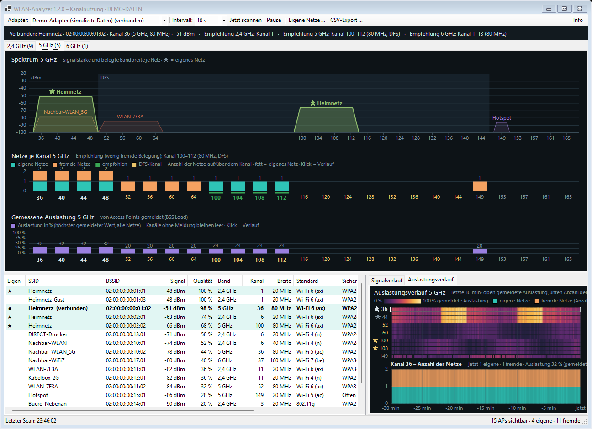

# WLAN-Analyzer (Windows)

Version 1.1.1 · Copyright Benjamin Johann · Lizenz: PolyForm Noncommercial
1.0.0 (siehe [`LICENSE`](LICENSE)) · Hinweise zu genutzter Software Dritter:
[`THIRD-PARTY-NOTICES.md`](THIRD-PARTY-NOTICES.md)

Ein eigenständiger Windows-Client, der mit dem **WLAN-Adapter des PCs** alle
WLAN-Netze in Reichweite ausliest und die **Kanalnutzung** zeigt – getrennt
nach eigenen und fremden Netzen. Er braucht weder die Router des
Mesh-Roaming-Dashboards noch InfluxDB/MQTT: alles, was er anzeigt, empfängt
der PC selbst aus der Luft.



*Ansicht mit simulierten Demo-Daten (`--demo --view load`) – keine echten Netze.
Im Demo-Modus sind beim Start schon 30 Minuten simulierter Verlauf vorhanden.*

## Was angezeigt wird

Je Band (2,4 / 5 / 6 GHz) ein Reiter mit:

- **Spektrum:** jedes Netz als Fläche über seiner tatsächlich belegten
  Bandbreite (20/40/80/160/320 MHz), Höhe = Signalstärke. Eigene Netze
  (★) kräftig in kühlen Farben, fremde blass in warmen Farben. Im
  5-GHz-Band ist der DFS-Bereich (Kanal 52–144) hinterlegt.
- **Kanalauslastung:** je 20-MHz-Kanal ein Balken, unten der Anteil eigener,
  oben der Anteil fremder Netze. Die Zahl über dem Balken ist die Anzahl der
  Netze, die den Kanal ganz oder teilweise belegen. Tooltip mit Details.
- **Empfehlung:** der Kanal mit der geringsten Belegung durch *fremde* Netze –
  im 2,4-GHz-Band einer der überlappungsfreien Kanäle 1/6/11, im 5- und
  6-GHz-Band ein 80-MHz-Block (bei Gleichstand ohne DFS).

Darunter:

- **Liste aller Access Points** (BSSIDs) mit SSID, Signal, Band, Kanal,
  Kanalbreite, Standard (Wi-Fi 4/5/6/7), Verschlüsselung, Zahl verbundener
  Geräte und gemeldeter Auslastung. Spalten per Klick sortierbar,
  Rechtsklick: Netz als eigenes markieren, SSID/BSSID kopieren. Nicht mehr
  sichtbare Netze bleiben zwei Minuten grau in der Liste.
- **Signalverlauf** der letzten 10 Minuten für das gewählte Band. Das in der
  Liste ausgewählte Netz wird in allen Diagrammen weiß hervorgehoben.
- **Auslastungsverlauf** der letzten 30 Minuten (Reiter neben dem
  Signalverlauf): oben eine Heatmap Kanal × Zeit (Farbe = Auslastung,
  schraffiert = geschätzt), darunter für einen Kanal der Anteil eigener und
  fremder Netze über die Zeit. Den Kanal wählt ein Klick auf eine Zeile der
  Heatmap oder auf einen Balken der Kanalauslastung; ohne Auswahl wird der
  Kanal des verbundenen Netzes gezeigt. Wird ein Netz nachträglich als
  eigenes markiert, gilt das auch rückwirkend für den Verlauf.
- **CSV-Export** des aktuellen Scans (Semikolon, für Excel).

## Woher die Auslastung kommt – und was sie bedeutet

Ein PC-WLAN-Adapter kann die Belegung eines Kanals nicht selbst messen.
Der Analyzer nutzt zwei Quellen:

1. **Gemessen (volle Balken):** Viele Access Points senden in ihren Beacons
   das Element *BSS Load* (IEEE 802.11, Element 11). Darin steht, wie viel
   Prozent der Zeit der AP seinen Kanal als belegt erkannt hat – durch alle
   Netze, eigene wie fremde – und wie viele Geräte bei ihm angemeldet sind.
   Melden mehrere APs denselben Kanal, gilt der höchste Wert.
2. **Geschätzt (schraffierte Balken):** Sendet kein AP auf dem Kanal BSS Load,
   wird ein *Belegungsindex* aus Anzahl und Signalstärke der Netze berechnet,
   die den Kanal überlappen (je Netz bis zu 20 Prozentpunkte, gewichtet von
   −95 dBm = 5 % bis −50 dBm = 100 %). Das ist keine Messung, sondern ein
   Anhaltspunkt für „wie voll ist es hier“.

Die **Aufteilung eigen/fremd** erfolgt im Verhältnis der angemeldeten Geräte
(aus BSS Load) der beteiligten APs, ohne diese Angabe im Verhältnis der
signalgewichteten Netzanzahl.

Damit die eigenen OpenWrt-Router BSS Load senden, muss es in hostapd
aktiviert sein (`bss_load_update_period`). Das ist auf OpenWrt nicht in
jeder Version standardmäßig an und wurde hier nicht auf den eigenen Routern
geprüft.

## Eigene Netze

Als eigen gilt:

- jede SSID, die unter **„Eigene Netze …“** angehakt ist (z. B. alle SSIDs
  des eigenen Mesh einschließlich Gast-WLAN), und
- standardmäßig das Netz, mit dem der PC gerade verbunden ist (abschaltbar).

Die Einstellungen liegen in `%APPDATA%\WlanAnalyzer\settings.json`.

## Voraussetzungen

- Windows 10/11 mit WLAN-Adapter und laufendem Dienst „WLAN AutoConfig“.
- **Windows 11 24H2 und neuer:** Windows gibt Scanergebnisse nur heraus, wenn
  unter *Einstellungen → Datenschutz und Sicherheit → Standort* sowohl die
  Standortdienste als auch „Desktop-Apps Zugriff auf Ihren Standort erlauben“
  eingeschaltet sind. Fehlt das, zeigt der Analyzer einen Hinweis mit Link zur
  Einstellung.
- Zum Bauen: Visual Studio 2022 (Workload „.NET-Desktopentwicklung“) oder
  das .NET 8 SDK. Keine weiteren NuGet-Pakete.

## Bauen und starten

**Visual Studio:** `WlanAnalyzer.sln` öffnen, F5. Über die Startprofile
(Dropdown neben dem Start-Button) lässt sich „WlanAnalyzer (Demo-Daten)“
wählen.

**Kommandozeile:**

```powershell
cd tools\WlanAnalyzer
dotnet build -c Release
.\WlanAnalyzer\bin\Release\net8.0-windows\WlanAnalyzer.exe
```

Optionen:

| Option | Wirkung |
|---|---|
| `--demo` | simulierte Netze statt echtem Adapter (zum Ausprobieren) |
| `--band 24\|5\|6` | mit diesem Band-Reiter starten (Standard 5) |
| `--view signal\|load` | unten Signal- oder Auslastungsverlauf zeigen (Standard signal) |
| `--screenshot datei.png` | nach dem ersten Scan Fenster als Bild speichern und beenden |
| `--version` | Versionsnummer anzeigen |

Die Versionsnummer steht in `WlanAnalyzer.csproj` (`<Version>`) und erscheint
in der Titelleiste, unter **Info** (dort auch Lizenz und Hinweise zu Software
Dritter) und in den Dateieigenschaften der EXE.

Eigenständige EXE ohne installierte .NET-Laufzeit:

```powershell
dotnet publish WlanAnalyzer -c Release -r win-x64 --self-contained -p:PublishSingleFile=true
```

`LICENSE` und `THIRD-PARTY-NOTICES.md` landen dabei automatisch neben der
EXE. Eine solche EXE enthält die .NET-Laufzeit (MIT-Lizenz). Wer sie
weitergibt, legt zusätzlich deren Lizenz und Drittanbieter-Hinweise bei
(Links in [`THIRD-PARTY-NOTICES.md`](THIRD-PARTY-NOTICES.md)).

## Aufbau des Quellcodes

| Ordner/Datei | Inhalt |
|---|---|
| `Wlan/WlanNative.cs`, `Wlan/WlanClient.cs` | Zugriff auf die Windows Native WiFi API (`wlanapi.dll`): Adapter, Scan, BSS-Liste, Verbindung |
| `Wlan/InformationElements.cs` | Auswertung der Beacon-Elemente: BSS Load, HT/VHT/HE/EHT (Kanalbreite, Mittenfrequenz) |
| `Wlan/WifiChannels.cs`, `Wlan/BssInfo.cs` | Kanal-/Frequenzraster, ein Access Point |
| `Scanning/` | Scan-Quellen: echter Adapter und Demo-Daten |
| `Analysis/` | Verlauf je AP, Kanalauslastung eigen/fremd, Kanalempfehlung |
| `UI/` | Hauptfenster, Diagramme (eigene GDI+-Controls), Dialog „Eigene Netze“ |

## Grenzen

- Der Analyzer sieht nur, was der PC an seinem Standort empfängt. Für ein
  Gesamtbild an mehreren Stellen im Haus messen.
- Windows scannt nicht beliebig oft; manche Treiber liefern bei bestehender
  Verbindung nur eine zwischengespeicherte Liste (Hinweis in der Statuszeile).
- 6-GHz-Netze erscheinen nur, wenn Adapter und Treiber 6 GHz unterstützen.
- Die Linkqualität („Qualität“) ist der Windows-Wert und erreicht bei starkem
  Signal schnell 100 %.

## Datenschutz

Der Analyzer speichert keine Scans. Liste, Signal- und Auslastungsverlauf liegen nur im
Arbeitsspeicher und sind nach dem Beenden weg. Nur der CSV-Export schreibt
eine Datei. Sie enthält SSIDs und BSSIDs auch fremder Netze und sollte nicht
weitergegeben werden.
